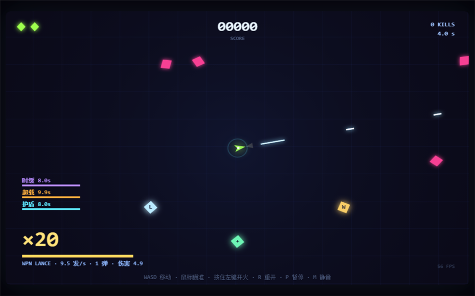

# NEON SWARM

街机爽感俯视双摇杆射击。单文件 HTML5，无构建、无外部资源。

**在线游玩：** https://cdcfishzz-ai.github.io/neon-swarm/



## 操作

- WASD / 方向键：移动
- 鼠标：瞄准
- 按住左键：开火
- R：重开 / 返回机库
- P：暂停
- M：静音
- F：全屏
- U：系统升级树

## 内容

- 连击驱动火力成长
- 60 秒波次 + 聚合 Boss + 三选一构筑
- 四色流派 / 品质 / 递减叠加上限
- 僚机成长体系
- 局外成长：Boss 残骸 → 数据碎片 → 永久强化
- 自适应音乐、专属 Boss BGM、子弹时间、叙事日志

## 本地运行

直接用浏览器打开 `index.html`，或在目录中启动任意静态服务器：

```powershell
npx serve .
```
